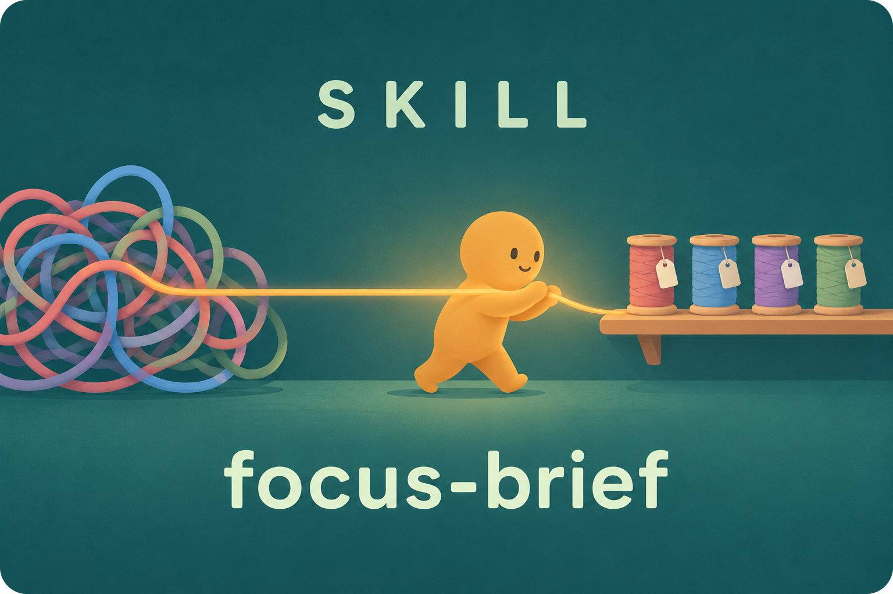

<!--
GitHub metadata, applied by hand in repo Settings (not rendered):
About: Shape every Claude Code reply into a six-part executive brief with the decision first, one active thread, a park list and time & cost — an output style, skill and plugin.
Topics (ranked): claude-code, claude-code-skill, claude-code-plugin, claude-skills, output-style, prompt-engineering, productivity, focus, executive-summary, adhd-friendly, accessibility, llm, ai-assistant, anthropic, markdown
Social preview: docs/media/hero-glass.jpg (1280x640, git-ignored) made from docs/media/hero.png with --glass.
-->

# focus-brief — Executive-Brief Replies for Claude Code

**Decision first. One thread at a time.**  
*A Claude Code output style and skill that shapes every reply into a six-part brief: the decision you need to make, what it is, how it works, what you do, cost and time, and what is parked.*

[](LICENSE)
[](.claude-plugin/plugin.json)
[](skills/focus-brief/SKILL.md)



| I want to… | Where | What it is |
|---|---|---|
| **Install it** | [`.claude-plugin/`](.claude-plugin/) | Two `claude plugin` commands, then pick the style in `/config` |
| **See the reply shape** | [`output-styles/focus-brief.md`](output-styles/focus-brief.md) | The six parts, the 15 rules, the pre-send check |
| **See what changes** | [`TESTS.md`](TESTS.md) | Five prompts, three setups, scored check by check |
| **Know where the rules came from** | [`THIRD-PARTY.md`](THIRD-PARTY.md) | Adapted from i-have-adhd, MIT |

## Install

```bash
git clone https://github.com/AdinathChaudhari/focus-brief ./focus-brief
claude plugin marketplace add ./focus-brief
claude plugin install focus-brief@focus-brief
```

Or, inside Claude Code 2.1.275 or later:

```
/plugin install focus-brief --marketplace AdinathChaudhari/focus-brief
```

In Claude Code: `/focus-brief`. To turn it off: `claude plugin disable focus-brief`.

**Always on:** in testing, the skill did not load by itself (see [TESTS.md](TESTS.md)). To apply it to every reply, use the output style instead:

```bash
cp output-styles/focus-brief.md ~/.claude/output-styles/
```

Then pick **Focus Brief** in `/config`. Run focus-brief or i-have-adhd, not both.

That's it. Everything below is detail.

---

## The reply shape

```
1. Your decision now   one line, plus A / B / C reply options
2. What it is          one plain sentence
3. How it works        3 to 5 numbered steps, never more
4. What you do         your part, with minutes
5. Cost / time         money or usage, and clock time
6. Paused / waiting    the park list, plus "Active thread: X. Step N of M."
```

Small answers use a short form: the answer, one state line, one next action.

## The rules

**Group A, adapted from i-have-adhd:** decision first · five steps at most · restate state, including what is paused · specific time and cost · one next action under two minutes · no preamble, plain words.

**Group B, new:** one active thread with a park list · one decision per message · understand-first gate (restate in three lines, wait for "go") · show before it leaves · cheap sample before the full run · digest agent reports, do not relay them · resume brief at session start · read the whole message before acting · complexity alarm.

Full wording, with a Bad/Good pair for each: [`SKILL.md`](skills/focus-brief/SKILL.md).

## Before and after

A real run from the test set. The prompt was *"Build me a small command line tool that renames all my screenshots by the date they were taken and moves them into monthly folders."*

**Before:** the reply opened with setup steps and a 100-line script. Nothing was asked first, and no cost was given.

**With focus-brief** (output style, first lines of the reply):

```
**1. Your decision now**
Where should the monthly folders go? Your reply also counts as "go" to start building.
Reply: A) ~/Desktop/Screenshots/2026-11/ / B) ~/Desktop/2026-11/  (recommended: A)

**2. What it is**
A single script called `tidyshots`. You run it in Terminal, and it gives each Mac screenshot
on your Desktop a date-based name, then files it into a folder for its month.
...
**5. Cost / time**
No money. ~10 min for me to build and test it on fake screenshots in a scratch folder.
```

Five prompts, three setups, scored check by check: [TESTS.md](TESTS.md).

---

## What it is not

focus-brief is a set of working rules, built from how one person works with Claude. It is not a diagnosis and makes no claims about attention or brain chemistry.

## Acknowledgements

focus-brief is a sister of **[i-have-adhd](https://github.com/ayghri/i-have-adhd)** by **Ayoub Ghriss**. Several rules (action first, numbered steps capped at five, state every turn, time estimates, no preamble, the pre-send check, when to break the rules) are adapted from it under the MIT License. The upstream notice is in [THIRD-PARTY.md](THIRD-PARTY.md). i-have-adhd describes itself as loosely based on *The Adult ADHD Tool Kit* by J. Russell Ramsay and Anthony L. Rostain.

## License

MIT © 2026 Adinath Chaudhari. See [LICENSE](LICENSE).
